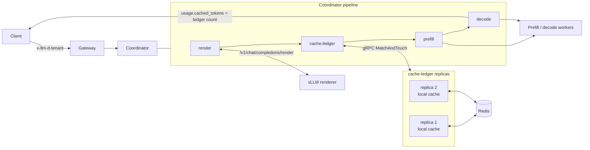
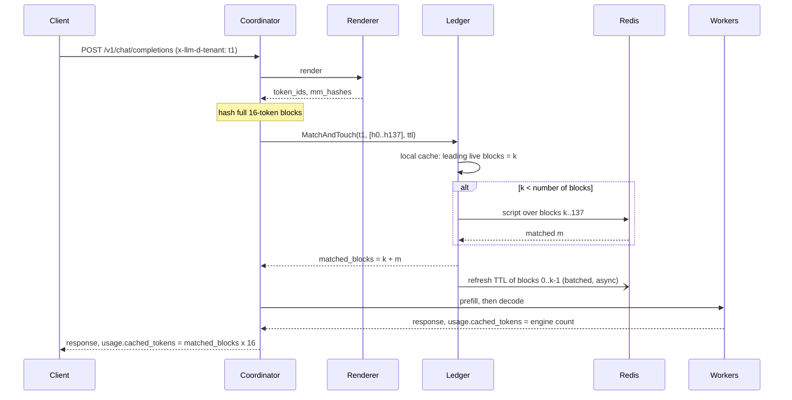

# Cache Ledger

The cache ledger bills prompt-cache hits against a retention window instead of
against the hits an engine realized. A prefix a tenant sent within the TTL is
reported as cached whether or not any engine still holds its KV blocks.

The ledger is a standalone gRPC service (`cmd/cache-ledger`). The coordinator's
`cache-ledger` pipeline step calls it once per request and writes the answer
into `cached_tokens` in the usage block the client receives.

## Motivation

Engines report realized hits: the prompt tokens whose KV blocks were still
resident on the pod that served the request. That number depends on decisions
the client cannot see or influence:

- which pod the router picked,
- what that pod evicted under memory pressure,
- whether a prefill/decode handoff happened.

Two requests with an identical prefix, sent a minute apart, can be billed
differently. Under realized-hit billing, a provider that improves routing or
adds KV offload earns less, because every extra hit is a discount.

Retention-based billing fixes the price at the time the client sends the
request: if the tenant sent this prefix within the TTL, it is billed as cached.
Realized hits remain an operational metric, and the gap between the two is the
cost of routing and eviction misses, which the provider absorbs.

## Goals and non-goals

Goals:

- Answer "how many leading prompt tokens did this tenant send within the TTL"
  in about a millisecond per request.
- Keep tenants isolated: one tenant's prompts never produce hits for another.
- Share state across ledger replicas, and keep it across restarts.
- Keep the wire contract language-neutral, so a renderer outside this
  repository can call the ledger.

Non-goals:

- Storing prompts or KV data. The ledger holds 64-bit hashes and expiry times.
- Routing. The ledger does not influence which pod serves a request.
- Pricing. The ledger reports token counts; rates belong to the billing system.

## Architecture



| Component | Role |
| :---- | :---- |
| `render` step | Tokenizes the request with the model's tokenizer and chat template. |
| `cache-ledger` step | Hashes the token IDs into blocks, calls the ledger, stores the result on the request context. |
| `decode` / `conditional-decode` steps | Rewrite `cached_tokens` in the response usage block with the ledger's count. |
| `cmd/cache-ledger` | Serves `MatchAndTouch` over a store: in-memory, Redis, or Redis with a local cache. |
| Redis | Holds the per-tenant block hashes shared by all ledger replicas. Expiry uses Redis key TTLs. |

## Request flow



If the request has no tenant header, render produced no token IDs, or the
ledger call fails or exceeds its timeout, the step leaves the count unset and
the client receives the engine's count unchanged. A ledger outage never fails
a request.

## Hashing

The ledger never sees tokens. The coordinator step hashes the rendered prompt
and sends only the hashes.

### Inputs

| Input | Source | Effect |
| :---- | :---- | :---- |
| Token IDs | `render` step output (chat template applied) | The prefix being billed. |
| Model name | request `model` field | Separates models and LoRA adapters. |
| `cache_salt` | request body, optional | Lets a client partition its own entries. |
| Media hashes | renderer `mm_hashes` plus placeholder offsets | Separates images whose placeholder tokens are identical. |
| Tenant | `x-llm-d-tenant` header | Not hashed. It is the namespace the hashes are stored under. |

### Chained block hashes

The prompt is split into blocks of `block_size` tokens (default 16). Each
block's hash covers its own tokens and the previous block's hash, so a block
hash identifies the entire prefix ending at that block. A trailing partial
block is not hashed and never billed as cached.

```
 tokens:   | t0 .. t15 | t16 .. t31 | t32 .. t47 | ... | t2192 .. t2207 | t2208 .. t2211 |
           +-----------+------------+------------+-----+----------------+----------------+
 content:      c0           c1           c2                  c137         (partial block,
                |            |            |                   |             not hashed)
                v            v            v                   v
 seed -----> [ h0 ] -----> [ h1 ] -----> [ h2 ] --> ... --> [ h137 ]

 seed   = xxh64( len(model) | model | len(salt) | salt )
 c[i]   = xxh64( le32(token) for each token in block i
                 | len(mm_hash) | mm_hash   for each media item overlapping block i )
 h[i]   = xxh64( le64(c[i]) | le64(h[i-1]) )        with h[-1] = seed
```

Two prompts that differ at token 500 share `h0 .. h30` and nothing after:

```
 prompt A:  [h0][h1] ... [h30][h31a][h32a] ...
 prompt B:  [h0][h1] ... [h30][h31b][h32b] ...
                              ^
                              first differing block: every later hash differs
```

Every client of one ledger must hash identically. The scheme is specified in the
comment on `cacheledger.BlockHashes` so that a non-Go client (for example a
Python renderer) can reproduce it.

## Matching

`MatchAndTouch(tenant, hashes, ttl)` does two things atomically per tenant:

1. **Match.** Count the hashes from the start of the list that are still within
   their TTL, stopping at the first miss. A retained hash after a miss does not
   count, because its prefix was not retained.
2. **Touch.** Extend every hash's expiry to at least `now + ttl`. Expiry only
   moves later; a request with a shorter TTL never cuts short a longer
   retention already promised.

The count reflects the state before this call's writes.

```
 time --->

 t=0s    t1 sends prompt P1          stored:  h0 .. h137            expire at 600s
         matched 0                   billed cached_tokens = 0

 t=30s   t1 sends P2 (same system    stored:  h0 .. h136            refreshed to 630s
         prompt, new question)                h137' (new)           expires at 630s
         matched 137                 billed cached_tokens = 137 x 16 = 2192

 t=40s   t2 sends P2                 namespace t2 is empty
         matched 0                   billed cached_tokens = 0

 t=700s  t1 sends P2                 h0 .. h136 expired at 630s
         matched 0                   billed cached_tokens = 0
```

## Stores

```
                   +------------------------------------------------+
  MatchAndTouch -->|  CachedStore (one per ledger replica)          |
                   |                                                |
                   |   local cache: tenant -> hash -> expiry        |
                   |   +------------------------------------------+ |
                   |   | h0 h1 h2 ... h136 | h137'  (miss)        | |
                   |   +------------------------------------------+ |
                   |     leading local hits = k     tail (k..n)     |
                   |              |                      |          |
                   |   refresh queue (async,             | sync     |
                   |   coalesced, every                  | Lua      |
                   |   flush-interval)                   | script   |
                   +--------------|----------------------|----------+
                                  v                      v
                   +------------------------------------------------+
                   |  Redis                                         |
                   |  llm-d:cache-ledger:{t1}:00ab..   PX 600000    |
                   |  llm-d:cache-ledger:{t1}:91fe..   PX 600000    |
                   |  llm-d:cache-ledger:{t2}:00ab..   PX 600000    |
                   +------------------------------------------------+
```

| Store | Flag | Properties |
| :---- | :---- | :---- |
| `MemoryStore` | `--store=memory` | One process. Sharded maps with per-shard locks. Lost on restart. |
| `RedisStore` | `--store=redis --local-cache-ttl=0` | Shared by replicas. One Lua script per call does the match and the writes. |
| `CachedStore` | `--store=redis` (default `--local-cache-ttl=1m`) | `RedisStore` with a per-replica local cache in front. |

### Redis layout

One key per (tenant, block hash), with the tenant in a hash tag:

```
llm-d:cache-ledger:{<tenant>}:<16 hex digits>
```

The hash tag keeps all of a tenant's keys in one Redis Cluster slot, which a
multi-key script requires. The hash has a fixed width, so two tenants cannot
produce the same key. Values are a constant; the information is in the key and
its TTL. Redis must run with `maxmemory-policy noeviction`, because an evicted
key is a hit the ledger owes and no longer reports.

### Local cache

A replica answers hits on blocks it recorded itself without calling Redis.
Expiry only moves later, so a block this replica knows is live stays live at
least until the local expiry.

- **Leading local hits** are answered from memory. Their TTL refresh is queued
  and written to Redis in batches every `--flush-interval` (default 200ms),
  coalesced across requests.
- **The tail** after the first local miss goes to Redis synchronously, since
  another replica may have recorded those blocks.
- **`--local-cache-ttl`** caps how long a block stays in the local cache, which
  bounds memory. A shorter value only sends more lookups to Redis.

Other replicas see a refresh up to one flush interval late, and refreshes queued
when a replica crashes are lost. Either can only cause another replica to
under-report a hit near the end of a TTL.

## API

```protobuf
service CacheLedger {
  rpc MatchAndTouch(MatchAndTouchRequest) returns (MatchAndTouchResponse);
}

message MatchAndTouchRequest {
  string tenant = 1;
  repeated fixed64 block_hashes = 2;  // chained, in prompt order
  uint32 ttl_seconds = 3;             // 0 selects the server default
}

message MatchAndTouchResponse {
  uint32 matched_blocks = 1;
}
```

The server rejects an empty tenant or more than `--max-blocks` hashes with
`InvalidArgument`, clamps the TTL to `--max-ttl`, and returns `Unavailable` when
the store fails. It also serves the standard gRPC health service.

## Configuration

Coordinator step (`config/coordinator/coordinator.yaml`):

```yaml
steps:
  - type: render
    params:
      address: "http://renderer:8000"
  - type: cache-ledger
    params:
      address: "cache-ledger:9500"   # required
      block_size: 16                 # billing granularity in tokens
      ttl: 1h                        # omitted: ledger --default-ttl
      timeout: 100ms
  - type: prefill
  - type: decode
```

The pipeline is rejected at startup if `cache-ledger` does not follow `render`.

Ledger flags:

| Flag | Default | Meaning |
| :---- | :---- | :---- |
| `--grpc-addr` | `:9500` | gRPC listen address. |
| `--metrics-port` | `9090` | Prometheus `/metrics`; non-positive disables it. |
| `--store` | `memory` | `memory` or `redis`. |
| `--redis-url` | | For example `redis://redis:6379/0`. |
| `--default-ttl` | `5m` | TTL when a request names none. |
| `--max-ttl` | `1h` | Upper bound on a requested TTL. |
| `--max-blocks` | `65536` | Maximum hashes in one request. |
| `--local-cache-ttl` | `1m` | Local cache lifetime with `--store=redis`; `0` disables the local cache. |
| `--flush-interval` | `200ms` | How often queued refreshes are written to Redis. |
| `--sweep-interval` | `30s` | How often expired in-process entries are dropped. |

Metrics:

| Metric | Meaning |
| :---- | :---- |
| `llm_d_cache_ledger_requests_total{result}` | Calls by `ok` / `error`. |
| `llm_d_cache_ledger_blocks_total` | Hashes received. |
| `llm_d_cache_ledger_matched_blocks_total` | Hashes reported as retained. |
| `llm_d_cache_ledger_local_blocks_total` | Hashes answered from the local cache. |
| `llm_d_cache_ledger_remote_blocks_total` | Hashes looked up in Redis. |
| `llm_d_cache_ledger_store_duration_seconds` | Store latency per call. |

## Tokenization

The ledger bills on rendered tokens, which is what the engine can reuse.

| Request | Token IDs come from |
| :---- | :---- |
| `/v1/chat/completions`, `/v1/responses`, `/v1/messages` | The vLLM renderer, with the model's chat template. |
| `/v1/completions` with a text prompt | The vLLM renderer, without a chat template. |
| `/v1/completions` with a token array, `/inference/v1/generate` | The client, used as sent. |

- The renderer and the workers must run the same model revision, tokenizer, and
  chat template. If they differ, the billed hits no longer correspond to what
  the engine could reuse.
- A tokenizer or chat template change produces new hashes for every prompt, so
  every tenant starts from zero hits for one TTL window. The engine cache is
  invalidated by the same change.
- Chat templates that rewrite earlier turns (stripping reasoning content,
  inserting the current date) change earlier tokens, which breaks the prefix in
  the ledger and in the engine alike.
- With `use_openai_format: true`, the render call exists only for the ledger
  and adds its latency to every request.

## API compatibility

| API | Status | Notes |
| :---- | :---- | :---- |
| OpenAI Chat Completions | Supported | Rewrites `usage.prompt_tokens_details.cached_tokens`, streaming and non-streaming. |
| OpenAI Responses | Supported | Rewrites `usage.input_tokens_details.cached_tokens`. |
| OpenAI Completions | Supported | Rewrites `usage.prompt_tokens_details.cached_tokens`. |
| Anthropic Messages | Not supported | The usage rewriter leaves the Messages schema untouched; see below. |

OpenAI caches every prefix implicitly, which matches the ledger. OpenAI only
caches prompts of at least 1024 tokens, in 128-token increments;
`block_size: 128` matches the increment, and the minimum is not implemented.
`prompt_cache_retention` is not mapped to a per-request TTL, and
`prompt_cache_key` is ignored.

Anthropic Messages needs:

1. A usage rewrite for the Messages schema that sets `cache_read_input_tokens`
   and `cache_creation_input_tokens` and recomputes `input_tokens`, which
   excludes both.
2. Cache writes in the response (`written_blocks`), since Anthropic reports and
   prices them separately.
3. `cache_control` breakpoints: record only up to the last breakpoint, with a
   TTL per breakpoint (`5m` or `1h`). The request would carry segments of
   `(end_block, ttl)` instead of one TTL, and the renderer would need to report
   the token offset where each marked content block ends.

## Scaling

```
                       +-------------+
  coordinator A ------>| ledger r1   |----+
                       +-------------+    |     +---------------+
  coordinator B ------>| ledger r2   |----+---->| Redis / Redis |
                       +-------------+    |     | Cluster       |
  coordinator C ------>| ledger r3   |----+     +---------------+
                       +-------------+
         client picks a replica by hash(tenant)
```

- **Ledger replicas** hold no state Redis does not also have, so they scale
  horizontally. The coordinator client uses gRPC's default `pick_first`
  policy, so through a ClusterIP Service each coordinator talks to one replica.
  Spreading load needs client-side balancing: round-robin over a headless
  Service, or a replica chosen by hashing the tenant. Hashing the tenant also
  keeps a tenant's prefixes in one replica's local cache.
- **Redis** runs each script to completion before the next, so one node bounds
  total throughput. Keys are laid out for Redis Cluster, but `RedisStore` uses a
  single-node client.
- **A single hot tenant** stays on one Redis slot and, with tenant-hashed
  routing, on one ledger replica.

## Failure modes

| Failure | Effect |
| :---- | :---- |
| Ledger unreachable or slow | The step times out (`timeout`, default 100ms) and the client receives the engine's count. |
| Redis down | Requests fully answered by a replica's local cache still succeed; others return `Unavailable` and fall back as above. |
| Ledger replica crash | Up to one flush interval of TTL refreshes is lost. Redis keeps all synchronously written entries. |
| Redis data loss | Every tenant starts from zero hits. |
| Missing `x-llm-d-tenant` | The ledger is skipped and the engine's count is reported. The gateway must set this header after authentication. |
| Hash collision | One block billed as cached that was not sent. Requires two distinct prefixes of one tenant to collide in 64 bits. |

## Open questions

- Should the hash scheme and usage semantics be agreed with vLLM, so its
  renderer and response path can call the ledger without the coordinator?
- Implicit caching of every prefix, or explicit breakpoints with a write premium?
- A per-tenant cap on stored entries.
- Reporting the realized count alongside the billed one (a header or metering
  event), and a metric for the gap between them.
- A tokenizer and chat template fingerprint in the hash seed, so a change is an
  explicit reset rather than a silent one.
- Replicas that own tenants, so a local miss is authoritative and Redis leaves
  the request path except after failover.
